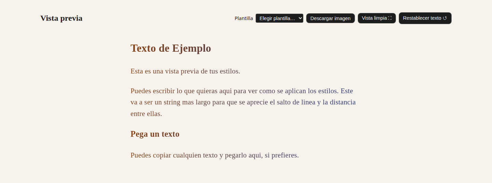

### 🎨 Estila Tu Texto

[](https://github.com/SebaRomeroX/estila-tu-texto/actions/workflows/ci.yml)

[Demo en Vivo](https://estilatutexto.netlify.app/) · [Código Fuente](https://github.com/SebaRomeroX/estila-tu-texto)

**Experimenta con estilos de texto y obtén el código listo para usar.** Una herramienta visual para diseñar tipografía sin escribir CSS manualmente.

### 🎯 ¿Qué hace?

1. Escribe o pega un texto (o usa el de muestra)
2. Ajusta todos los estilos tipográficos facilmente
3. Ve el resultado exacto en tiempo real
4. Copia el HTML + CSS generado y úsalo en tu proyecto

> > Ideal para diseñadores, maquetadores y devs que quieren resultados rápidos sin pelearse con el CSS.

### 🖼️ Vista Previa



_Tema Editorial con degradado de texto, tal como se ve en el editor._

### 🛠️ Tecnologías

- **React** (con Hooks)
- **Vite** para desarrollo y build
- **CSS** con variables y layout responsive
- **Vitest + Testing Library** para tests unitarios y de integración
- **Playwright** para tests de navegador (CSS real, contraste y export PNG)
- **JSDoc + TypeScript** (`checkJs`) para tipar el dominio
- **Netlify** para despliegue

### ✨ **Control Total de Tipografía**

- ✅ **Familia tipográfica** (select con opciones)
- ✅ **Tamaño** (number input)
- ✅ **Peso** (100-900)
- ✅ **Color** (color picker)
- ✅ **Interlineado (line-height)**
- ✅ **Espaciado entre letras (letter-spacing)**, incluido tracking negativo
- ✅ **Espacio entre palabras y sangría de primera línea**
- ✅ **Versalitas y corte de línea** (normal, balanceado, pretty)
- ✅ **Alineación del texto**
- ✅ **Temas predefinidos** (Clásico, Editorial, Consola, Impacto), **temas propios guardados en este navegador** y restablecer estilos
- ✅ Las propiedades tipográficas esenciales, sin CSS a mano

### ⚡ **Experiencia en Tiempo Real**

- **Vista previa instantánea** de todos los cambios
- **Código generado al momento** (HTML + CSS)
- **Sin recargas, sin clicks extra**

### 📋 **Código Listo para Usar**

- Botón **"Copiar código"** con un click, o **copiar HTML y CSS por separado**
- Vista de **editor**: resaltado de sintaxis HTML/CSS y números de línea
- Formato limpio y legible
- HTML semántico con tu texto
- CSS con las propiedades exactas que elegiste

### 🔧 **Flexibilidad Total**

- **Texto editable:** usa el default, escribe algo nuevo o pega otro texto
- **Contraste verificado:** indicador WCAG en vivo (AAA / AA / insuficiente) del par texto/fondo
- **Lectura cómoda:** tamaño en `rem`, ancho de línea en `ch` y `line-height` sin unidad
- **Padding ajustable:** margen interno del bloque en píxeles, igual en preview, snippet e imagen
- **Fondo transparente:** bloque sin fondo para incrustarlo en cualquier superficie; el preview usa un tablero de referencia y el PNG se exporta transparente
- **Énfasis:** mayúsculas, capitalizar, subrayado, tachado y cursiva
- **Compartir por URL:** el enlace lleva tu texto y tus estilos, sin backend
- **Título a tu medida:** escala del título (100-200%) sin tocar los párrafos
- **Título independiente:** fuente, peso y color propios para el título, sin cambiar los párrafos
- **Subtítulo independiente:** fuente, peso, color y tamaño propios para el subtítulo, sin tocar el resto del texto
- **Fuentes que no mienten:** selector visual (cada fuente se ve en sí misma), Roboto y Open Sans self-hosteadas (sin pedidos a terceros) + aviso si una fuente del sistema no está instalada
- **Descargar .html:** archivo autónomo con tu texto y estilos, listo para abrir sin la app
- **Descargar imagen PNG:** la vista previa tal como se ve (fondo o transparencia incluidos) en 2x, ideal para redes
- **Vista limpia:** pantalla completa con solo tu texto estilado, sin controles, para leer o mostrar
- **Temas propios:** guarda la combinación actual con un nombre y reaplícala cuando quieras (se queda en este navegador)
- **Deshacer y rehacer:** historial de la sesión con `Ctrl/Cmd+Z` y `Ctrl/Cmd+Shift+Z`, sin llenarse de pasos al arrastrar un control
- **Letra capitular:** la primera letra del primer párrafo con tamaño editorial, en el preview y en el snippet
- **Plantillas de texto:** ensayo, blog, cuento y carta para arrancar sin escribir; avisa antes de reemplazar tu texto
- **Sombra de texto:** presets suave y resplandor para dar profundidad o un halo del color del texto
- **Selección personalizada:** elegí el fondo y el color del texto al seleccionar, con aviso de contraste WCAG
- **Degradado de texto:** dos colores en gradiente sobre título, subtítulo y párrafos, sin tapar el fondo del bloque
- **Dos columnas:** el bloque pasa a dos columnas con los títulos ocupando todo el ancho
- **Arquitectura extensible:** diseñada para añadir nuevos estilos sin tocar lógica core

**Componentes Especializados por Tipo de Input**

Fácil de extender: ¿nuevo estilo? solo crea su input y añádelo al estado

### 🚀 Instalación Local

```bash
git clone https://github.com/SebaRomeroX/estila-tu-texto.git
cd estila-tu-texto
npm install
npm run dev
```

**Scripts útiles:** `npm run lint` · `npm test` · `npm run test:coverage` · `npm run test:e2e` · `npm run build`

Los tests de navegador usan Playwright con Chromium: la primera vez ejecutá `npx playwright install chromium`.

### 🧪 Calidad

- **222 tests** unitarios y de integración con Vitest y Testing Library.
- **100% de cobertura** en la lógica pura (`src/lib/**`): estilos, contraste, snippet, persistencia y compartir por URL.
- **5 tests de navegador** con Playwright: variables CSS computadas, contraste real, dos columnas y exportación PNG (incluida la transparencia).
- **CI** con formato, lint, typecheck, cobertura, build y e2e en cada push.

### 💡Lecciones Clave

**Diseño pensando en el futuro:** La arquitectura con un solo estado y componentes reutilizables hace que añadir nuevas funcionalidades sea trivial

**Balance en optimización:** A veces queremos que todo sea perfecto desde el día 1, pero la busqueda de la sobreoptimización puede entorpecer el progreso

### 🧠 ¿Qué Motivó el Proyecto?

Estaba experimentando cómo las propiedades tipográficas (fuentes, line-height, letter-spacing) afectan el impacto visual de un sitio. Además, conozco muchos desarrolladores a los que les impacienta estilar texto, así que construí una herramienta que lo hace practico y rápido.

### 🔮 Próximas Mejoras (Ideas)

Export a Tailwind (CSS utilitario en vez de CSS plano)

Migrar a Zustand si el estado se vuelve más complejo

### 👨‍💻 Autor

[Seba Romero](https://sebaromerox.github.io/portafolios/)

**Deja una estrella si te resultó útil ⭐**
